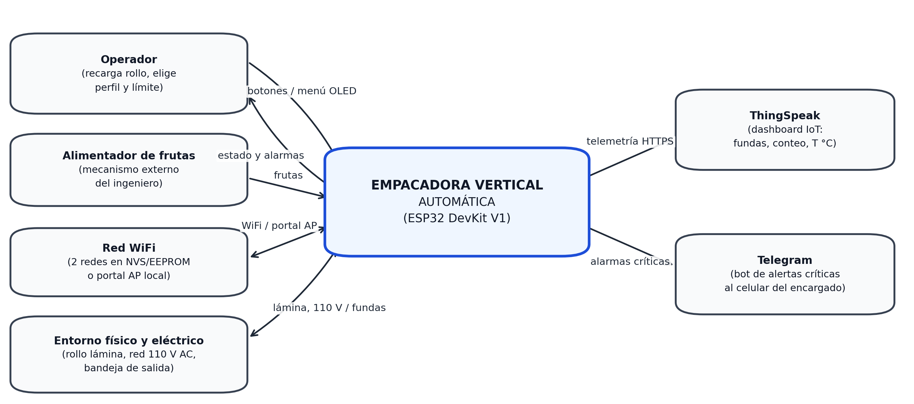
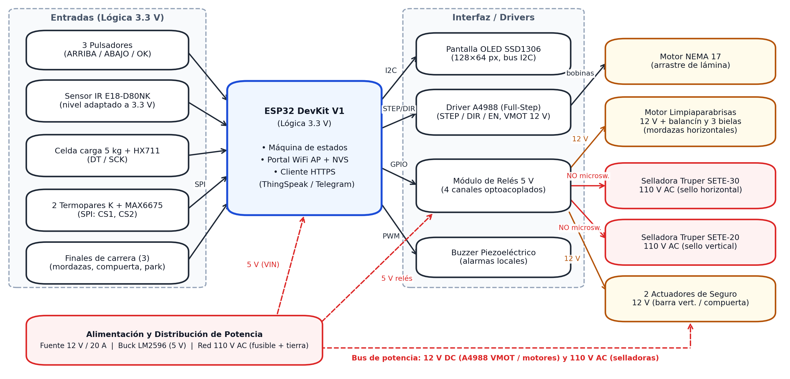
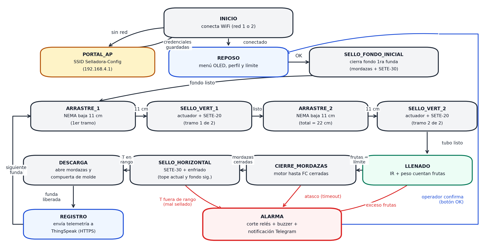

# empacadora-vertical-esp32
# Empacadora Vertical Automática de Frutas con ESP32

**Escuela Superior Politécnica del Litoral (ESPOL)**  
Facultad de Ingeniería en Electricidad y Computación — *Sistemas Embebidos*  

* **Integrantes:**
  * Allan Moises Chacha Leon — Matrícula: `202304135`
  * Axel Andrés Alejandro Jiménez — Matrícula: `202213161`
* **Paralelo:** 2  
* **Fecha:** 17/11/2026  

---

## 1. Introducción

En fincas pequeñas y puestos de venta la fruta todavía se empaca de forma manual: se cuenta, se introduce en la funda y se sella una por una. Este proceso consume tiempo y produce fundas con cantidades inconsistentes o sellos defectuosos. Nuestro proyecto consiste en una **empacadora vertical automática (tipo VFFS)** controlada por ESP32 que toma lámina plana desde un rollo, la conforma en tubo, cuenta las frutas que caen en su interior y realiza el sellado térmico al alcanzar la cantidad configurada. El operador únicamente recarga el rollo y supervisa el proceso.

**Objetivo general:** diseñar e implementar, con una ESP32, una empacadora vertical que forme, llene, cuente y selle fundas de fruta de manera automática y reporte su estado operacional por internet.

**Objetivos específicos:**
* Formar el tubo de empaque a partir de lámina de 40 cm mediante un formador tipo cuello de camisa (PETG) sobre un tubo de 110 mm.
* Controlar el largo exacto de cada funda (22 cm) con un motor paso a paso NEMA 17 y driver A4988.
* Contar las frutas mediante un sensor infrarrojo (IR) y una celda de carga, incluso cuando caen dos o tres unidades simultáneamente.
* Ejecutar el sellado vertical y horizontal con selladoras de impulso, supervisando la temperatura con termopares tipo K.
* Configurar la red WiFi desde un portal cautivo propio en modo AP, almacenar dos redes en memoria no volátil (emulación EEPROM/NVS en Flash) y enviar telemetría a ThingSpeak y alertas críticas a Telegram.

---

## 2. Alcance y limitaciones

* **Lo que se construye:** un prototipo funcional de 88 × 50 cm en estructura de triplex de 12 mm con arrastre continuo de lámina, barra de sello vertical, mordazas de sello horizontal accionadas por motor de limpiaparabrisas, molde con compuerta para descarga de la funda, conteo híbrido de frutas, interfaz local en pantalla OLED, perfiles configurables por tipo de fruta (peso unitario y límite por funda) y de rollo (tiempo de impulso térmico), portal web WiFi en modo AP, tablero en ThingSpeak y alarmas por sobretemperatura, mal sellado, exceso de frutas y atasco mecánico. La etapa lógica opera a 3.3 V en protoboard, mientras que toda la etapa de potencia (110 V AC y 12 V DC) se aísla mediante relés y borneras. **Presupuesto máximo:** $300.
* **Lo que no resuelve:** el alimentador de frutas es provisto por el ingeniero del proyecto; nuestro sistema solo recibe la fruta en la tolva. No clasifica frutas por calidad o calibre ni realiza empacado al vacío. El conteo utiliza un peso unitario promedio calibrado, por lo que frutas con alta dispersión de peso pueden introducir error. Frutas mayores a ~10 cm de diámetro no atraviesan el tubo de 110 mm. El corte entre fundas se realiza manualmente sobre la franja del sello horizontal (una cuchilla automatizada queda como mejora futura). No es un equipo de grado alimenticio certificado ni para operación industrial continua (las selladoras requieren ciclos de 50 min de trabajo por 20 min de descanso).

---

## 3. Diagrama de contexto

El sistema central (**Empacadora Vertical Automática con ESP32**) interactúa con seis entidades externas:
1. **Operador:** configura perfiles, límites de conteo y calibración desde el menú OLED con tres pulsadores, recibiendo estado operativo y alertas sonoras.
2. **Alimentador de frutas:** mecanismo externo que dosifica las frutas hacia el tubo formador.
3. **Entorno físico y eléctrico:** suministra el rollo de polietileno y la alimentación de 110 V AC, y recibe las fundas selladas en la bandeja.
4. **Red WiFi:** medio por el cual la ESP32 se conecta a internet usando dos credenciales respaldadas en NVS/EEPROM o despliega su propio Access Point si no hay cobertura.
5. **ThingSpeak:** plataforma que registra telemetría histórica de fundas, conteo y temperatura.
6. **Telegram:** bot que envía notificaciones inmediatas de alarma al teléfono del encargado.

---

## 4. Diagrama de bloques del diseño

La **ESP32 DevKit V1 (lógica de 3.3 V)** centraliza la adquisición de datos y el control secuencial. En las entradas lee 3 pulsadores de navegación, un sensor IR **E18-D80NK** (con adaptación de nivel a 3.3 V) para detectar el paso de fruta, una celda de carga de 5 kg con amplificador **HX711** para calcular cuántas frutas cayeron en grupo, dos termopares tipo K con módulos **MAX6675** por bus SPI (CS independientes) para medir la temperatura de ambas selladoras, y 3 finales de carrera (mordazas cerradas, posición *park* y compuerta). En las salidas comanda la pantalla **OLED SSD1306** por I2C, un buzzer local, el driver **A4988** que gobierna el motor **NEMA 17** de arrastre de lámina, y un módulo de 4 relés optoacoplados de 5 V.

En la etapa de potencia, una fuente de **12 V / 20 A** alimenta directamente el motor de limpiaparabrisas (que cierra las mordazas horizontales mediante un balancín y tres bielas sin cruce mecánico en giro continuo), dos actuadores de seguro de 12 V (uno presiona la barra vertical y otro abre la compuerta de descarga) y la potencia (**VMOT**) del A4988; un convertidor **Buck LM2596** reduce a 5 V para el módulo de relés y el regulador interno de la ESP32. Las selladoras **Truper SETE-30** (horizontal) y **SETE-20** (vertical) fueron desarmadas para montar sus resistencias y gomas en la estructura, dejando sus transformadores de 110 V AC y temporizadores en un compartimento cerrado trasero; los relés se conectan en paralelo al microswitch original para conservar el ajuste térmico de fábrica.

---

## 5. Diagrama de software / Máquina de estados

Al energizarse (`INICIO`), la ESP32 intenta enlazarse a las redes WiFi guardadas en memoria no volátil; si falla, levanta el portal cautivo `PORTAL_AP` (`192.168.4.1`) hasta guardar credenciales válidas y pasa a `REPOSO`. Al confirmar arranque (`OK`), ejecuta `SELLO_FONDO_INICIAL` para cerrar el extremo inferior de la primera funda y evitar caída libre de fruta. Luego el ciclo de fabricación se divide en dos tramos (`ARRASTRE_1` → `SELLO_VERT_1` → `ARRASTRE_2` → `SELLO_VERT_2`) de 11 cm cada uno (22 cm totales), ya que la resistencia vertical mide 20 cm.

Con el tubo formado, `LLENADO` contabiliza las frutas mediante IR y peso hasta alcanzar el límite configurado. Después `CIERRE_MORDAZAS` acciona el motor hasta activar el final de carrera de cierre y `SELLO_HORIZONTAL` activa la SETE-30 (sellando simultáneamente el tope de la funda actual y el fondo de la siguiente) con tiempo de enfriamiento. Finalmente `DESCARGA` libera la funda y `REGISTRO` publica los datos en ThingSpeak (~12–15 s por ciclo). Cualquier anomalía (exceso de frutas, atasco por *timeout* o temperatura fuera de rango) transita a `ALARMA`, cortando relés, activando el buzzer y notificando por Telegram hasta que el operador confirme en sitio.

---

## 6. Diseño de interfaces

| Interfaz | Especificación técnica y protocolo |
| :--- | :--- |
| **Usuario – máquina** | Pantalla OLED SSD1306 128×64 (I2C: GPIO 21 SDA, GPIO 22 SCL) y 3 pulsadores con pull-up (GPIO 32, 33, 25: ARRIBA/ABAJO/OK) para selección de perfil, límite de frutas, calibración de peso y rearme. Buzzer activo en GPIO 4. |
| **Configuración de red** | Portal web embebido en modo AP (SSID `Selladora-Config`, IP `192.168.4.1`) con formulario HTML para dos SSID y contraseñas almacenados en NVS/EEPROM. |
| **ESP32 – sensores (3.3 V)** | IR E18-D80NK con divisor/pull-up a 3.3 V (GPIO 34); HX711 (GPIO 16 DT, GPIO 17 SCK); 2× MAX6675 por SPI (GPIO 18 SCK, GPIO 19 MISO, GPIO 5 CS1, GPIO 14 CS2); 3 finales de carrera (GPIO 35, 36, 39). |
| **ESP32 – actuadores** | A4988 en paso completo (200 pasos/rev; 184 pasos = 22 cm con polea Ø 7.6 cm; GPIO 26 STEP, GPIO 27 DIR, GPIO 13 EN). Módulo de 4 relés de 5 V (GPIO 23, 15, 2, 12 con aislamiento) para motor 12 V, selladoras (contacto NO en paralelo al microswitch) y actuadores. |
| **ESP32 – nube IoT** | Cliente HTTPS hacia API REST de ThingSpeak (fundas, frutas, temperaturas y alarmas, respetando intervalo ≥ 15 s) y API de Bot de Telegram para alertas instantáneas. |

---

## 7. Alternativas de diseño

| Decisión elegida | Alternativa descartada | Justificación técnica y compromiso asumido (*trade-off*) |
| :--- | :--- | :--- |
| **Empacadora vertical con lámina en rollo** | Bandeja con fundas preformadas | Automatiza el formado, llenado y sellado sin intervención manual; requiere mayor precisión mecánica en el tubo formador. |
| **Formador cuello de camisa (PETG)** | Formador cónico tipo embudo | Pliega la lámina de 40 cm sobre el tubo de 110 mm sin arrugas en la costura; se valida primero en cartulina antes de imprimir en 3D. |
| **Selladoras Truper SETE-20/30 desarmadas** | Barra casera de alambre nicrom | Aprovecha resistencia, teflón, transformador y temporizador calibrados de fábrica con repuestos locales. *Compromiso:* ciclo térmico máx. 50/20 min. |
| **Relé mecánico en paralelo al microswitch** | Relé de estado sólido (SSR) | Reutiliza el temporizador original de perilla sin electrónica de cruce por cero adicional. *Compromiso:* menor vida útil mecánica frente a SSR. |
| **Motor limpiaparabrisas + balancín y 3 bielas** | Actuador lineal o servomotor | Alto torque, bloqueo mecánico por tornillo sin fin sin consumo en reposo y giro unidireccional continuo sin choque de bielas. |
| **Motor paso a paso NEMA 17 + A4988** | Motor DC con encoder | Garantiza avance repetible de 22 cm por conteo de pasos en lazo abierto con menor costo y complejidad de control. |
| **Fusión sensor IR + celda de carga HX711** | Solo barrera infrarroja (IR) | El IR detecta el instante de caída y el incremento de peso determina cuántas frutas cayeron juntas; exige frutas de peso relativamente uniforme. |

---

## 8. Plan de test y validación

| Prueba | Procedimiento experimental | Criterio de aceptación |
| :--- | :--- | :--- |
| **Largo de funda** | Ejecutar 20 ciclos de arrastre y medir longitudinalmente cada funda. | 22.0 ± 0.5 cm en el 100 % de muestras. |
| **Calidad de sellos** | Sellar 20 fundas con 5 limones, invertir y agitar vigorosamente 10 s. | 0 fugas, sin quemaduras ni perforaciones. |
| **Control térmico** | Comparar lectura MAX6675 vs. termómetro patrón; forzar sobretiempo. | Error < 5 °C; disparo de alarma en < 2 s. |
| **Conteo híbrido** | Empacar 30 fundas incluyendo caídas simultáneas de 2 y 3 frutas. | ≥ 95 % de fundas con conteo exacto. |
| **Mordazas y atasco** | Correr 100 ciclos continuos; obstruir cierre deliberadamente. | 0 atascos en operación; alarma al bloquear. |
| **WiFi y NVS/EEPROM** | Apagar router principal; luego apagar red 1; reiniciar ESP32. | AP activo en < 30 s; conmuta a red 2; persiste datos. |
| **Telemetría IoT** | Completar fundas y provocar alarmas térmicas y de conteo. | Registro en ThingSpeak; Telegram en < 10 s. |
| **Arranque en frío** | Realizar 10 ciclos de encendido/apagado consecutivos. | Ningún relé ni selladora se activa en el *boot*. |
| **Paro de emergencia** | Activar paro físico / fallo crítico durante impulso de sellado. | Corte de potencia en < 0.5 s y bloqueo en `ALARMA`. |
| **Ciclo completo** | Operar 50 fundas consecutivas en modo automático. | ≤ 15 s por funda sin intervención manual. |

---

## 9. Consideraciones éticas

* **Seguridad eléctrica, mecánica y contra humedad:** el sistema opera con 110 V AC, mordazas móviles y resistencias térmicas. Los transformadores y borneras se alojan en un compartimento cerrado con fusible y puesta a tierra, aislados de posibles salpicaduras o jugos de fruta; además incorpora paro de emergencia físico, protección de mordazas por *timeout* y corte automático por sobretemperatura.
* **Inocuidad alimentaria:** se emplea película de polietileno virgen apta para contacto con alimentos y se protocoliza la limpieza del tubo formador antes de cada jornada (para producción comercial se recomienda migrar el tubo a acero inoxidable sanitario).
* **Impacto ambiental y laboral:** el control exacto de largo evita desperdicio de plástico, los perfiles térmicos admiten láminas biodegradables más delgadas y se reutiliza un motor automotriz. En pequeños productores, automatiza una tarea repetitiva y permite reubicar al trabajador en labores de supervisión y control de calidad.
* **Privacidad y transparencia operativa:** no se recolectan datos personales de operadores y las credenciales de WiFi, ThingSpeak y Telegram se gestionan fuera del código público en GitHub. Toda funda con excedente de frutas se marca y notifica como alarma en lugar de despacharse como conforme.
